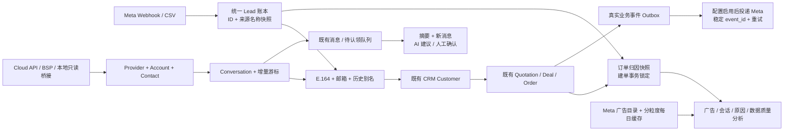

# Meta → Customer → WhatsApp → Order → Ad

## CURRENT STATE AUDIT

需求理解：身份链优先，UI 次之；重复留资不得覆盖来源；不确定的电话关联必须暂停自动绑定。此次请求已明确授权审计后继续实施，不再重复请求 PROJECT_RULES §0.5 的确认。

整体影响：Growth / Sales / Order 共用 Customer 主记录。既有 LeadSubmission、MetaLeadEvent、WhatsAppMessage、CustomerIntelligence、Quotation、Deal、Order 保留。真实报价、成交、付款与 AI 推断分离。影响级别 L3。

涉及模块（代码扫描）：meta-import-service、meta-lead-service、customer-service、whatsapp-identity-service、whatsapp-web-sync-service、whatsapp-webhook-service、whatsapp-message-service、deepseek-customer-service、whatsapp-stage-service、order-service、quotation-service、meta-ads-service、meta-graph。调用入口：CSV 导入、Meta/WhatsApp webhook、本地桥接、客户编辑/成交、报价发送、Growth/Order/客户工作台。

已发现：webhook duplicates 选择首个客户；CSV 与 webhook 幂等账本分离；CSV 精确时间被截断；订单仅关联客户/成交，没有订单时点广告快照；桥接历史消息未维护客户行为时间；AI 可把询价写为已报价；Graph 翻页丢 cursor 并重复版本路径。WhatsApp 已有消息去重与待认领，不另造并行消息库。

数据库检查边界：已检查完整 Prisma 模型、迁移、服务与之前只读 CRM 数据。当前源码没有 DATABASE_URL，不能声称已经检查生产约束或部署迁移；仅在隔离 MySQL 测试库演练。预存在 docs/audits 的用户文件不改。

## ARCHITECTURE PLAN

Customer 是 CRM 主键；ContactIdentity 是可多客户的联系方式索引（历史别名永久保留）。CustomerLeadAttribution 是跨 CSV/webhook 的统一留资账本，leadKey 全局唯一。电话冲突返回 AMBIGUOUS，不用尾号自动匹配、不合并客户。WhatsApp Contact/Conversation 按 provider/account/外部 ID 分区，消息继续存既有 WhatsAppMessage，未绑定内容继续存 WhatsAppUnmatchedMessage。

OrderAttribution 在建单事务固定首次/末次留资快照；默认末次有效 Meta 留资作为报告口径，同时保留首次来源。没有可追溯来源时标注 UNATTRIBUTED，后补历史不会静默改写已固定订单。AI 只给建议，HUMAN 覆盖保留独立字段。广告转换反馈使用唯一 eventId 台账、可恢复投递锁及同一 eventId 重试；未配置标 NOT_CONNECTED。

## DATA MODEL CHANGES

仅新增表、nullable/default 列和索引；不改变受保护唯一键、已有字段类型、单例 ID、软删除。新增 ContactIdentity、CustomerLeadAttribution、WhatsAppContact、WhatsAppConversation、IdentityAudit、OrderAttribution、AdvertisingFeedback、AdDimension、AdDailyMetric、SyncJob、DailyAdInsight。扩展 Customer 标准电话/邮箱、人工阶段来源；扩展 Message 可选 conversation、Intelligence 增量游标及 AI/人工结构化分析。

历史回填独立、分页、幂等，默认 dry-run；不得随 GET 执行。线上迁移只做结构变化，不自动修改历史资料。

## IMPLEMENTATION PLAN

1. 身份解析与统一留资事务：Lead ID → 电话 → 邮箱 → 人工；跨路径锁与唯一约束。
2. 会话分区、增量游标、未匹配/冲突持久化、人工绑定审计，复用已有桥接。
3. 订单建单同事务快照、真实业务反馈台账；AI 增量且不自动改事实阶段。
4. 广告粒度缓存与只读分析 API，四个 BOS 分析页面、同期比较、数据质量/丢失原因。
5. 隔离 MySQL 全量与旧库升级演练；身份链 A–F 场景、权限、并发、重复消息、不可归因、AI 人工覆盖；prisma/TypeScript/lint/build。

API：新增 /api/identity-chain（客户/订单追溯）、/api/identity-chain/reconcile（管理员幂等补齐）、/api/identity-chain/claim（人工归属）、/api/advertising-feedback（内部计算/显式投递）、/api/analytics/*、/api/customer-intelligence。均保留 {success,data}；销售只能看自己的客户，广告花费及跨客户冲突名单仅管理员。

UI：新增 /analytics/ads、/analytics/conversations、/analytics/loss-reasons、/analytics/data-quality，复用 BOS 原语，不重构旧页面。未知成本/零分母/未连接显示 — 或状态；不同币种不累加。

风险/回滚：追加 Prisma 生成迁移；失败保留现有数据，代码回滚不删除新增表。迁移不自动回填；历史冲突交人工。pnpm build 会 production-init 写库，所以验证必须显式指向隔离测试库。第三方 token 不写前端，不替换线上配置，不运行生产 smoke。

## DELIVERY REPORT · 2026-10-03

此报告对应本地源码与隔离 MySQL 8.4 验收。未部署生产，未连接真实 Meta CAPI 或发送 WhatsApp。测试夹具、模拟 Graph/AI/投递响应只存在于隔离验收，不用于业务页面填数。原始需求中的示例数值未写入线上数据。

### 1. Architecture Overview

身份链的保障来自稳定主键、唯一事件键、事务、外键、历史快照、冲突队列和人工审计。外部 API 中断时，先保留错误与待处理事件；恢复配置后重试。不能把“永远不断”解释为第三方永不故障或所有历史来源都可恢复：缺失证据保持未知，系统不猜测绑定。

### 2. 修改文件与影响范围

影响等级 L3。保留 Customer / LeadSubmission / MetaLeadEvent / WhatsAppMessage / CustomerIntelligence / Quotation / Deal / Order；未重建第二套 CRM、报价或订单。原有唯一键、Setting 单例、软删除和任务 tombstone 保留。旧成交补单脚本增加 historical 标记，只补订单，不在旧留资账本补齐前固定未知来源，也不自动生成历史 Purchase；正式新成交仍同事务固定来源与反馈。

| 领域 | 主要文件 |
| --- | --- |
| 号码与留资身份 | `lib/contact-identity.ts`、`services/contact-identity-service.ts`、`services/meta-import-service.ts`、`services/meta-lead-service.ts`、`services/customer-service.ts`、`lib/meta-lead-fields.ts` |
| WhatsApp | `services/conversation-identity-service.ts`、既有 `whatsapp-identity` / `whatsapp-webhook` / `whatsapp-web-sync` / `whatsapp-message` / `whatsapp-stage` 服务、`lib/whatsapp-web-sync.ts`、既有 webhook 路由 |
| AI 与人工确认 | `services/customer-intelligence-service.ts`、`services/deepseek-customer-service.ts`、`components/bos/IntelligenceReview.tsx` |
| 归因与反馈 | `services/order-attribution-service.ts`、`services/advertising-feedback-service.ts`、既有 `order-service.ts`、`quotation-service.ts`、`workflow-service.ts` |
| 分析与恢复 | `services/identity-chain-service.ts`、`identity-analytics-service.ts`、`identity-maintenance-service.ts`、`meta-ad-facts-service.ts`、`meta-lead-ad-snapshot.ts`、`lib/meta-graph.ts` |
| 页面 | `app/analytics/[section]/page.tsx`、`app/analytics/ads/[adId]/page.tsx`、`IdentityTimeline.tsx`、`IdentityRepairPanel.tsx`、既有客户详情 / SalesOS / OrderDetail / Sidebar、`app/bos.css` |
| API | `/api/identity-chain` 与 ad / claim / review / reconcile；`/api/customer-intelligence`；`/api/advertising-feedback`；`/api/analytics/*`；`/api/meta/retry`；`/api/cron/identity-chain` |
| 数据与验收 | `prisma/schema.prisma`、3 条新迁移、`tests/identity-*.test.ts`、`feedback-delivery.test.ts`、`meta-pagination.test.ts`、旧集成测试适配、测试库防误写脚本、`package.json` / 新 `pnpm-lock.yaml` / `.env.example` |

Sales Workspace 的 Decimal 汇率转为字符串后再传给客户端，修复浏览器验收中出现的 React 序列化告警。订单详情原来从 client 组件调用 `rmb()` 导致服务端渲染失败，现将格式化移到纯 `lib/order-format.ts`，保留原格式和列表导出兼容。时间线显示公司时区的年月日时分。未修改用户已有 `docs/audits/` 文件。完整文件状态保留在本地 Git 工作区；本次未提交或推送。

### 3. 新增数据库表 / 字段

| 新表 | 保留的关键证据与约束 |
| --- | --- |
| ContactIdentity | 客户 + 类型 + 标准联系方式唯一；同号码可存在于多个客户，避免唯一约束掩盖真实冲突；保留原值与历史别名 |
| CustomerLeadAttribution | `leadKey` 全局唯一；Meta ID 全部字符串；客户归属、匹配状态、原始回答、电话原值 / E.164、时间、Campaign / Ad Set / Ad / Creative / Form ID 与名称快照 |
| WhatsAppContact | provider + account + peer 的 hash 唯一；MATCHED / UNMATCHED / AMBIGUOUS / MANUAL |
| WhatsAppConversation | provider + account + 外部会话 ID 的 hash 唯一；关联联系人、增量游标、最后消息 / 收发 / 同步时间 |
| IdentityAudit | 人工认领、冲突解除、分析修正的操作者、依据及前后归属 |
| OrderAttribution | 一单一快照；首次 / 末次 Lead、广告层级、订单时点来源与锁定时间；无来源明确 UNATTRIBUTED |
| AdvertisingFeedback | `eventId` 唯一；事件时间、客户 / Lead / Order、真实金额与币种、不可变 payload、投递状态 / 响应 / 重试 / 租约 |
| AdDimension | account + ad 唯一的目录缓存；Campaign / Ad Set / Creative ID 与名称，预留素材分类 |
| AdDailyMetric | account + ad + 自然日 + grain + platform + country 唯一；AD / PLATFORM / COUNTRY 不混加 |
| SyncJob | 来源、任务、状态、执行时间、处理 / 成功 / 失败计数、脱敏错误 |
| DailyAdInsight | 时间范围 / 时区 / 筛选生成稳定报告键，保留数据证据、模型与摘要 |

既有表新增：Customer 的 `phoneE164`、`emailNormalized`、`stageSource`；WhatsAppMessage 的 nullable `conversationId`；WhatsAppUnmatchedMessage 的 provider、真实 providerAccountId、canonicalConversationId；CustomerIntelligence 的 summary、aiAnalysis、humanOverrides、增量分析游标、待处理 / 错误与跟进建议时间；MetaImportRun 的 nullable `resultPayload` JSON。

`stageSource` 对旧客户默认 HUMAN，目的是保护现有阶段，不代表已核验旧阶段的历史来源。原 VARCHAR 导入结果列不改类型；大量导入完整结果存 JSON，旧记录仍可读原 result。500 条导入及相同 token 重放均验证。

新增迁移均为加性结构变更，无改旧列类型 / 删除 / 自动回填：

1. `20261003153000_identity_chain_foundation`
2. `20261003163000_whatsapp_provider_account_identity`
3. `20261003170000_meta_import_result_payload`

第三条在本次未发布的隔离演练中，首次生成曾带入旧 TEXT 默认值漂移，执行第一条 DDL 即失败且应用步数为 0；已按 schema 前后差异重新生成，仅保留新增 JSON 列，再标记本次失败记录 rolled-back 后成功应用。原有 13 条与前两条成功迁移均未改写。干净旧库重新演练 13 → 16 条全部成功，0 条未解决失败记录。

### 4. Meta Lead 流程

签名校验 → 持久登记 MetaLeadEvent → Bearer token 读取原始 Lead → 映射实际表单字段 → 短事务统一身份解析 → 创建 / 关联 Customer → 追加统一来源账本与 LeadSubmission → 留存错误或成功状态。精确 `created_time` 与原始 JSON 保留；CSV、Webhook、重试共享 `meta:<leadId>` 事件键。

重复提交只新增留资与来源，不覆盖旧联系方式 / 来源快照。表单同时提供电话与 WhatsApp 时，两个标准号码都成为历史别名。姓名、尾号相似只供人工核对，不自动绑定。市场回答不会写为客户实际国家；数量区间不会猜成上限。

有广告读取配置时，处理新 Lead 可独立获取广告 / 素材名称快照；可选目录请求失败会记日志，不阻断已获取的 Lead。未获取的字段保持空。失效 token 的 Lead 留存 FAILED，后台或管理员可重试；并发租约与跨入口锁避免重复客户。

### 5. WhatsApp 同步流程

继续使用原 Cloud API / Coexistence、Gupshup BSP 和已有 Local Sync Bridge。统一层负责 provider / account / peer / conversation 身份，消息仍存原表。Cloud 签名校验后逐条入库；单条失败保留其他成功记录并返回可重试状态。无 CRM 匹配时进入待认领，不根据陌生聊天创建客户。

本地扩展仍是读取本人已登录账号当前可见业务对话的只读同步助手，需用户触发采集；没有新增自动发信、删除、群发或绕过登录。它不能保证自动抓取全部历史记录。官方 Cloud API 也不能任意读取旧 Business App 的所有聊天。

消息唯一键复用；不同账号收到相同 provider message ID 会进入冲突队列，不串到旧会话。媒体原文 / 文件名 / 类型保留；无法取得内容不阻断文本。游标按最后时间推进，延迟到达的历史消息维护首次最小值、最后最大值，重复同步不重复入库。MANUAL 认领固定后续归属；历史已归属消息不搬家。

### 6. Phone Matching 流程

先查 Meta Lead ID 的既有归属，再查所有 E.164 电话 / WhatsApp / waId / 历史别名，最后规范邮箱；找不到或冲突交人工。空格、短横线、括号、`00`、国际 `+` 及带国家代码的本地电话统一处理。国家未知的本地号码不猜；号码格式可解析不等于号码实际可达。

客户改号前后的号码都保留。重复号码包含其他客户或回收站记录时停止自动关联，不因姓名相同或其中一个客户已存 waId 就选第一人。人工认领须选可访问客户并填写依据，IdentityAudit 保存记录。跨客户 / 跨订单查询越权返回 404；销售只能访问自己客户，花费与跨客户冲突统计限管理员。

### 7. AI Analysis 流程

已保存新消息标记 analysisPending → 摘要 + 前次分析 + 人工决定 + 最多 60 条新消息 → DeepSeek 结构化 JSON → Zod 校验 → 比对增量游标 → 保存 AI / 人工 / 最终值。游标使用入库时间和 ID，避免漏掉后来同步的旧聊天。

提取采购身份、公司 / 地区、产品型号、数量、贸易条款、敏感度、意向 / 分数、A–D 质量、顾虑、标准丢失原因、建议阶段 / 下一步与摘要。未知数量为 null。采购证据优先于消息数量，区分销售话术和客户回复，原始对话中的指令不执行。

AI 不自动改真实阶段、有效性、报价、成交、成本或付款。真实收发可推进 SYSTEM 新客户 → 已联系 / 已回复，正式 SENT 报价与真实成交维护各自事实；HUMAN 阶段保留。人工可在时间线表单修正分析字段，保留依据与并发版本；未来 AI 更新继续保留人工值。A / B 建议按实际沟通锚点提供 24h / 48h 跟进提醒，复用旧任务去重与删除 tombstone。

未配置 DeepSeek 时返回 NOT_CONNECTED，原客户 / 消息 / 订单照常使用；失败保持待分析并记录错误。每天的广告摘要持久化真实聚合证据，只作建议，不改变广告预算。

### 8. Advertising Attribution 流程与指标口径

真实 Deal 与 Order 同事务建立归因快照；选订单日期之前已匹配且有 Ad ID 的首次 / 末次 Lead，报告默认末次 Meta 触点。快照建立后不因广告改名、客户改号、后来重复留资或历史回填而静默重写。无来源固定为 UNATTRIBUTED，需业务核对，不靠当前广告名称补猜。

订单 → 客户 → 原 Lead / Campaign / Ad Set / Ad / Creative 可反查；广告页 `/analytics/ads/[adId]` 按权限展示对应留资、客户、会话计数、客户历史报价，以及固定归属于该广告的订单 / 真实销售额 / 毛利。客户多广告留资不等于每个广告都获得同一订单。

| 指标 | 当前实现口径 |
| --- | --- |
| CRM 留资 / 客户质量 | 所选时间内统一账本；按周期内首次 / 末次触点每客户计一次；联系 / 回复 / 报价为截至当前的历史事实 |
| 平台 Leads / CPL | 平台归因线索与 CRM 留资分别列出；CPL = 花费 / 平台 Leads |
| Reply / Valid / Wholesale / High Intent / Quote 成本 | 花费除对应去重客户数量；有效以人工/真实业务确认为准，高意向使用 AI 与人工最终分析 |
| 每单成本 | 花费 / 订单数；不声称等同于首次获客 CAC |
| Revenue / Gross Profit | 实际 Deal 的成交日期、金额、币种与已登记成本/毛利；无财务证据不推算 |
| Revenue ROAS / Profit ROAS | 相同币种已知财务值 / 已知广告花费；不跨币种相加，不用缺失值或零分母制造结果 |
| Reach | 不把多个广告 / 自然日的 Reach 直接相加；该聚合保持未知 |
| 时间 / 比较 | 公司时区的客户与成交窗口；Meta 账号自然日的花费；默认最近 7 天与前 7 天比较，支持 8 种范围与最多 366 天自定义 |

四个页面为 `/analytics/ads`、`/analytics/conversations`、`/analytics/loss-reasons`、`/analytics/data-quality`，复用 BOS、最大 1440px。广告表按订单 / 有效客户 / 留资优先排序并分页；消息按 ID + 时间分页，不全量加载聊天。所谓漏斗显示各项事实，独立日期口径不保证计数严格递减。

素材身份只采用原 Lead 快照，不用当前 Ad 的 Creative 冒充旧来源。目录中有素材分类预留字段，但没有自动给视频猜“工厂 / 开箱 / 装柜”等类别。按素材分组或素材筛选时，历史素材成本标 UNAVAILABLE_FOR_CREATIVE_HISTORY：仅有广告每日花费不能可靠拆到换过的素材版本。产品 / 采购身份 / 销售负责人或平台+国家组合筛选没有相应花费分解时，同样不分摊假成本；仍可看真实客户和订单。

### 9. Meta Feedback 流程

已匹配且有原始时间的 Lead → 每 Lead 的稳定事件；已保存真实 OUTBOUND 消息 → 每客户 Contacted；真实有效确认 / 成交 → QualifiedLead；人工确认 HIGH → HighIntentLead；正式 SENT 报价 → QuoteSent；有 Deal 的未取消订单 → Purchase。Purchase 使用真实 Deal 金额、原币与业务日期，草稿报价 / AI 询价建议不产生成交反馈。

事件先在业务事务内创建唯一 Outbox，不调用外部网络。phone / email 规范化后 SHA-256，关联原 Lead ID。投递使用管理员显式调用或服务器 Cron；默认关闭，缺配置为 NOT_CONNECTED，不伪造成功。只在 Meta 返回 `events_received=1` 后标 SENT，错误保存状态码 / code / trace，不存含 token 的错误全文。

并发租约、5 分钟失效锁、退避重试复用同一 event_id 与 payload；超过允许事件时间窗口标 STALE，取消订单不投递。网络语义是至少一次尝试 + Meta 根据 event_id 去重，不宣称网络层绝对 exactly-once。真实 Dataset 对 Lead / 自定义 Contacted / HighIntentLead / QuoteSent 等事件的接受、匹配质量和平台自身 Lead 去重仍需在 Events Manager 中验收，不能用本地测试替代。

### 10. 上线需要的配置

不要在聊天或源码提供秘密值；在服务器私有环境变量 / 既有集成设置中配置。

| 功能 | 配置与需核验的授权 |
| --- | --- |
| 数据库 / 登录 | DATABASE_URL、AUTH_SECRET、SEED_ADMIN_PASSWORD、DEFAULT_TIMEZONE / DEFAULT_CURRENCY；沿用生产已有配置 |
| Lead Webhook | META_APP_SECRET、META_LEAD_WEBHOOK_SECRET（兼容 META_LEAD_VERIFY_TOKEN）、META_PAGE_ACCESS_TOKEN；对应 Page 的 Lead 读取及 webhook 订阅权限 |
| 广告与表单目录 | META_AD_ACCOUNT_ID、META_ADS_ACCESS_TOKEN、可选 META_PAGE_ID、META_GRAPH_VERSION；广告只读与相应 Page / 表单读取权限 |
| WhatsApp Cloud / Coexistence | 既有 Embedded Signup 配置与验证 token；业务 phoneNumberId / WABA / 加密保存的 access token；多号码时 WHATSAPP_PREFERRED_PHONE_NUMBER_ID；须验证正确账号的订阅与发送权限 |
| BSP | 沿用 GUPSHUP_API_KEY / SOURCE / APP_NAME / WEBHOOK_SECRET |
| Local Bridge | 无新第三方服务密钥；CRM 现有账号授权扩展、本人已登录 WhatsApp Web，账号作用域一致 |
| 增量 AI | DEEPSEEK_API_KEY / BASE_URL / MODEL；验证实际额度、模型 JSON 格式与超时 |
| CAPI | META_DATASET_ID、META_CAPI_ACCESS_TOKEN、META_FEEDBACK_ENABLED=true；Dataset / 账号对应关系、事件写入权限与 Events Manager 诊断 |
| 后台维护 | META_SYNC_SECRET；POST `/api/cron/identity-chain` 的 `x-cron-secret`，body.kind = leads / analysis / daily / feedback / all |

建议部署平台分别调度 Lead 重试、分析、反馈（如每 5 分钟，按实际处理时长调整）与每日摘要；广告目录沿用原 Meta 同步入口。POST worker 实现已完成，外部定时器尚未配置。不要把 Cron secret 放公开前端，也不要并发执行大量 `all` 任务。本次未创建 Codex 定时自动化。

### 11. 已实现且在本地验证的能力

CSV 与 webhook 共用身份账本；号码别名保留；重复 / 冲突安全暂停；Cloud/BSP/Bridge 接入统一会话；消息持久化与人工认领；客户 / 订单 / 广告双向追溯；增量 AI 与人工覆盖；真实报价 / 订单归因与反馈台账；后台恢复入口；真实数据分析与缺口展示。

均为现有项目内实际 service / API / 数据库代码，不是展示用 Dashboard。未知数据不填假广告、不用 AI 猜财务。销售隔离、管理员花费权限、签名与 secret 校验、冲突 / 幂等 / 并发 / 重试 / 回填均有测试覆盖。

### 12. 尚未真实启用 / 无法替代的环节

本地未持有生产 Meta / WhatsApp / AI token，不能宣称真实 webhook 已订阅、Meta Dataset 已接受回传或真实 DeepSeek 已分析客户。生产迁移、备份、历史回填与平台 Cron 均未执行。

历史来源本来缺少 Lead / Ad / Creative ID 时无法保证还原；旧会话没有业务账号元数据时标 `legacy:unknown`，不会冒充当前 Cloud 会话。既有本地桥接不保证自动遍历全部聊天。素材历史成本和未定义的客户维度花费分摊仍不可用。广告质量与低质量 Lead 建议保留建议属性，不自动暂停 / 改预算 / 新建 Campaign。

### 13. 如何验收完整链路与安全升级

先在生产副本按项目规则演练；本次使用本机隔离 MySQL，不是生产数据副本。不要使用 `prisma db push` 替代正式迁移。

1. 备份目标生产数据库并在副本验证当前迁移状态、用户、客户、订单及原始消息计数。安装锁定依赖，生成 Prisma client，应用 3 条新增迁移。不要改写已应用的迁移。
2. 历史补齐先 POST `/api/identity-chain/reconcile`，`dryRun:true`，按 customers → submissions → events → messages → orders 分页；检查 READY / CONFLICT / UNATTRIBUTED 后再在授权部署中提交。保留 nextCursor，错误逐条处理，不静默合并或覆盖订单快照。
3. 用真实 Meta 测试 Lead：核对 CRM 只有一个客户、Lead 原始时间及广告层级快照；同 Lead 重送和同号码新 Lead 再次提交，分别验证幂等与追加来源。
4. 从指定 WhatsApp 业务账号接收 / 同步该号码消息；核对 provider/account、唯一消息、首次 / 最后事实时间。重复同步无重复；陌生号码待认领，同号多客户 AMBIGUOUS，人工确认后后续消息归属正确。
5. 运行 AI：检查采购证据、未知量 / 地区、建议阶段与真实阶段分离；修改人工结果后同步晚到消息，人工值和旧消息保持。未配置 AI 时应显示未连接。
6. 创建报价草稿不算已发送，正式标记 SENT；注册真实成交 / 成本 / 币种。订单反查原 Lead / 广告，之后再提交其他广告的 Lead，已有订单来源应固定。
7. 默认只检查 Outbox，不能显示发送成功。配置 Dataset 后先在 Meta 的真实测试机制中核验事件与诊断，再按用户授权启用回传；失败重试需保持 event_id、订单金额与原币不变。
8. 核对广告按币种、触点模型、客户 / 订单日期口径，以及未知成本 / 未归因 / token 失败；在 1600px 和 390px 查看布局与控制台。

`pnpm build` / `pnpm start` 的 production-init 会 migrate deploy、首次创建管理员、仅在产品库为空时运行产品种子，并按 dealId 幂等补齐旧成交订单；仍然不是只读检查命令。2026-10-04 发布检查修正了覆盖现有管理员密码及产品资料的行为，并禁止自动标记未知失败迁移为已回滚。部署须使用服务器原有环境并先验证副本，不能直接对生产运行测试或 smoke。`pnpm test` 仅允许本机 / CI 的 MySQL `*_test` 数据库。生产实际引擎经只读查询为 MariaDB 11.8.9，CI 已增加 MariaDB 11.8 验证矩阵；CI 通过前不得视为兼容性验收通过。

回滚代码时保留新增表和列，不删身份历史；先停维护任务和 CAPI，再回旧代码。生产迁移与修复应保留备份、审计与平台日志，不自动 resolve 未知失败迁移。

### 14. 验证结果与证据

隔离 MySQL 8.4：99 项测试通过，0 失败 / 跳过，包含 A–F 六个完整场景、500 行首次导入 + 500 行重复留资、完整结果幂等重放 / 旧结果兼容、双号码别名、独占反馈租约、同一 payload 重试、跨账号消息冲突、晚到历史消息、AI 人工覆盖、AI 请求期间人工成交 / 负责人变更保护、历史旧成交补单后再归因、人工采购身份与批发统计一致、权限与 Cron secret。

干净旧库 13 → 16 条迁移部署成功。原 User / Customer / MetaImportRun 各 1 条哨兵保留；客户名称、电话、WhatsApp、邮箱、备注、阶段与 updatedAt 未改变；新增标准字段与 resultPayload 仍为空，证明结构迁移没有擅自回填。第一次隔离演练失败已修复，最终干净演练 0 条未解决失败记录。

Prisma validate / generate、Tests、ESLint、TypeScript 严格检查、Next 生产 Build 均已运行并通过。页面验收及日志摘录见 [验收证据](identity-acceptance/README.md)。没有运行远程 CI，没有推送或部署；本地结果不等同于线上端到端验收。
